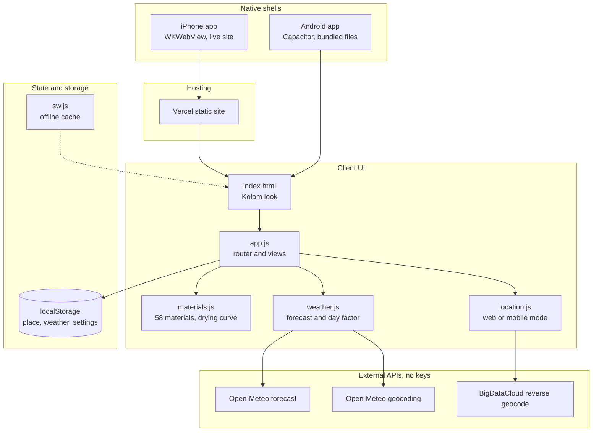
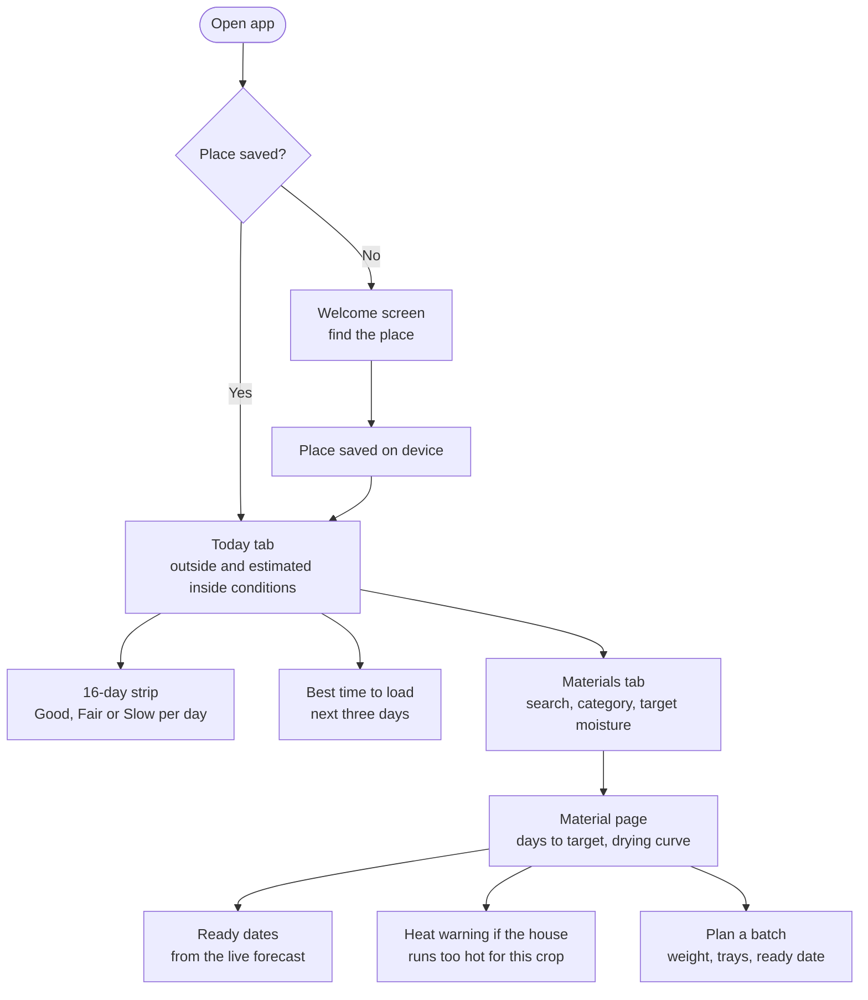
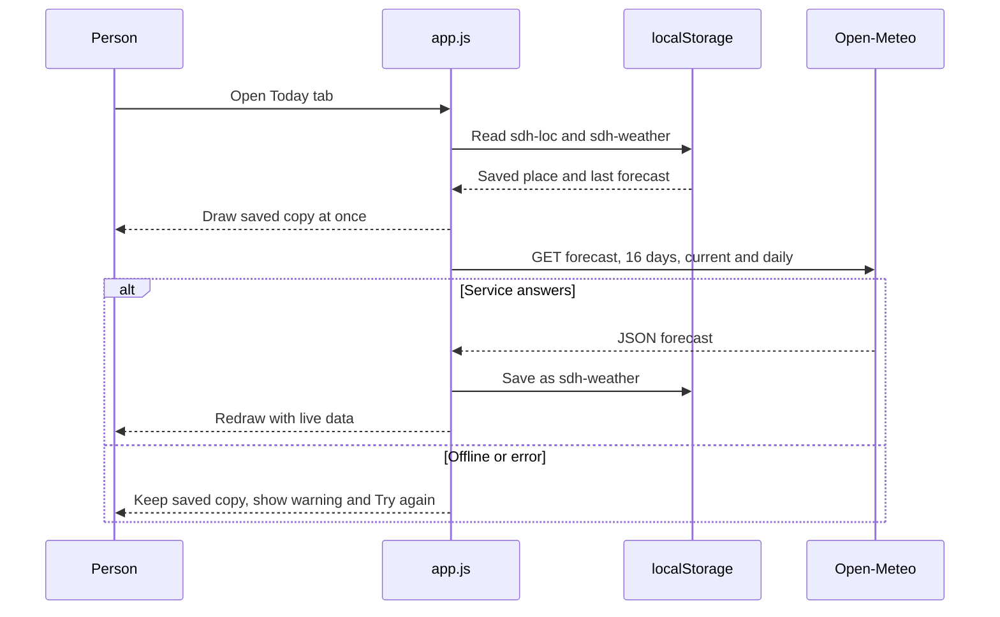
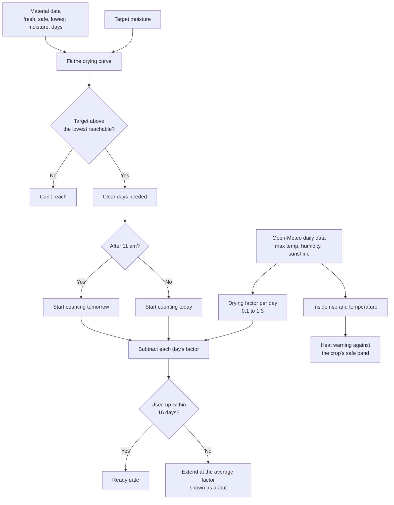
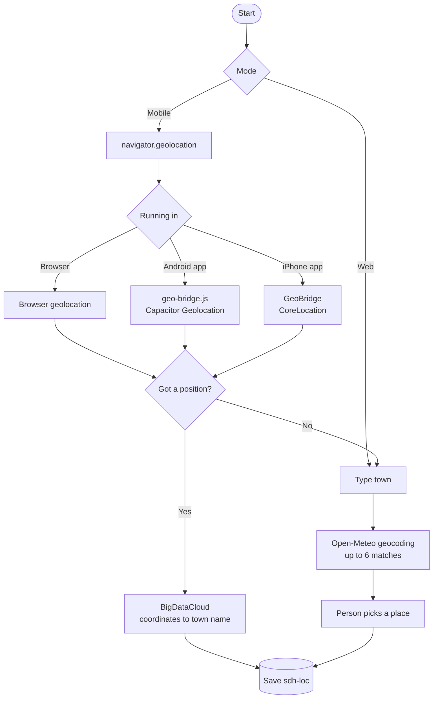
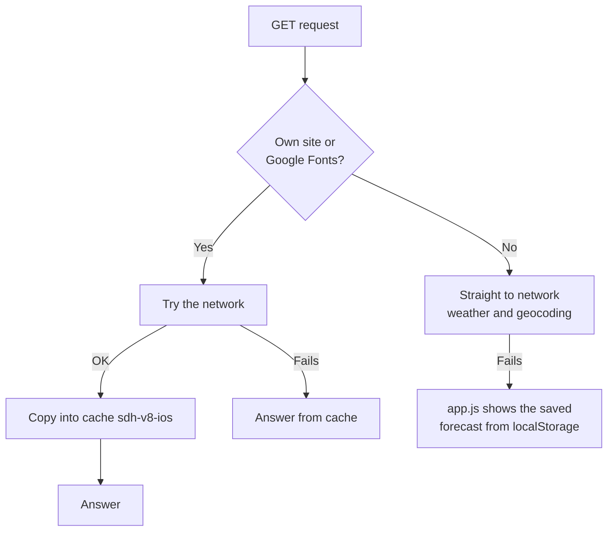
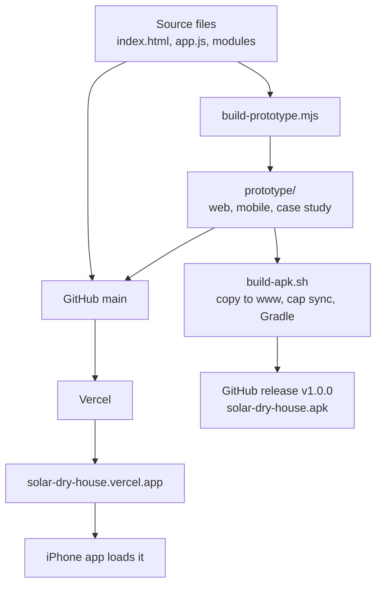

# Solar Dry House

Solar Dry House helps farmers who dry produce in a greenhouse-type solar dryer. It reads the live 16-day forecast for the dryer's town and turns it into a ready date for each of 58 crops and farm materials, plus a batch calculator and a how-it-works guide. The main idea is small and honest: each material has a drying curve fitted to typical guide values, each forecast day gets a "drying factor" from sunshine and humidity, and the app walks the forecast until the drying work is used up. Everything runs in the browser. There is no backend and no account.

| | |
|---|---|
| **Platforms** | Web/PWA, Android (bundled Capacitor app), iPhone (WKWebView shell) |
| **Stack** | Plain HTML, CSS and ES modules, no framework, no build step for the site |
| **Data** | 58 materials in `materials.js`, live weather from Open-Meteo, place and settings in localStorage |
| **Hosting** | Vercel static site, deployed from GitHub `main` |

## System architecture

The whole app is one page, `index.html`, driven by `app.js`. It imports three small modules: `materials.js` (the data and the drying-curve maths), `weather.js` (forecast calls and the inside-the-house estimates) and `location.js` (where the dryer is). A hash router draws four tabs: Today, Materials, Batch and Guide, plus a detail page per material.

The browser talks straight to three free, keyless services: Open-Meteo for the forecast, Open-Meteo's geocoder for typed towns, and BigDataCloud for turning GPS coordinates into a town name. The native shells add only two things: a native location bridge and a user-agent token that switches on the platform look.

_One static page, three modules and three free APIs. The Android app ships its own copy of the files; the iPhone app loads the live site._

## Main user flow

The core job is "I have this crop, when will it be dry?". The first step is always knowing where the dryer is. After that the Today tab shows the forecast and the best day to load, and a material page shows the ready date.

_Every route is a hash: `#home`, `#materials`, `#m/<id>`, `#calc/<id>`, `#guide`._

## Data flow and state

The key request is the forecast. On start the app shows any saved forecast for the same place at once, then asks Open-Meteo for a fresh one. A forecast younger than 30 minutes is not fetched again unless the person taps Refresh, changes place, or the browser comes back online.

_The saved forecast is only reused if its coordinates are within 0.01 degrees of the current place._

| State | Where it lives | Notes |
|---|---|---|
| Place | localStorage `sdh-loc` | Name, region, lat, lon and source: typed, gps or link. A `?place=Name\|lat\|lon` link can set it. |
| Last forecast | localStorage `sdh-weather` | One entry: place, fetch time and the raw Open-Meteo JSON. |
| Target moisture | localStorage `sdh-target` | Default 3%. The Materials tab offers 3, 5, 8 and 10%. |
| Tray area | localStorage `sdh-area` | Default 36 m², used by the batch calculator. |
| Search and category | In memory only | Reset on reload. |
| Photo credits | `images/credits.json` | Fetched on start, shown under each material photo. |
| App files | Cache Storage `sdh-v8-ios` | Written by the service worker on the website only. |

## How forecast days become drying dates

There are two halves. The first is per material and ignores the weather: how many clear, sunny days it needs to reach a moisture level. The second is per day and ignores the material: how much drying that day is worth compared with a clear reference day. The ready date comes from putting them together.

### Per material: the drying curve

Each material stores its fresh moisture `mi`, safe storage moisture `ms`, the lowest moisture a solar dryer can reach `me` and the typical days to reach safe storage `d`. `daysTo()` converts these to a dry-weight basis and fits an exponential curve through "fresh at day 0" and "safe at the typical days". It then solves that curve for any target. If the target is at or below `me` it returns "can't reach". At the default 3% target, 34 of the 58 materials can't reach it; at 10% only 5 can't.

### Per day: the drying factor

`days()` in `weather.js` reads each forecast day's maximum temperature, mean humidity and total sunshine (shortwave radiation in MJ/m²) and works out:

| Value | Rule in the code |
|---|---|
| Temperature rise inside | 25 °C × sunshine ÷ 22 MJ, kept between 3 and 28 °C |
| Midday inside temperature | Outside maximum plus the rise |
| Inside humidity | 70% of outside humidity, halved for every 11 °C of rise, kept 5 to 100% |
| Sun part | (sunshine ÷ 20 MJ), capped at 1.4, to the power 0.9 |
| Humidity part | 1 − 0.008 × (humidity − 65), kept between 0.6 and 1.15 |
| Drying factor | Sun part × humidity part, kept between 0.1 and 1.3 |
| Day label | Good at 0.85 or more, Fair at 0.55 or more, otherwise Slow |

The app has no hard go/no-go per crop. Instead every day counts for part of a clear day, and a crop-specific heat check warns when the house is likely to run more than 2 °C above the crop's safe band in the next five days.

_`daysTo()` in materials.js and `finishDate()` in weather.js. Rain chance and cloud cover are fetched but do not change the factor; rain chance only appears in the day tooltip._

The Today tab's "Best time to load" card uses the same factors: it looks at start days within the next four and picks the one whose next three days add up to the most drying. The "inside now" numbers on the hero card use a separate rule based on the current sunshine in W/m².

## Location: device GPS or a typed town

`appMode()` decides between two behaviours. It is "mobile" when the page is installed (standalone display), opened on an Android or iOS user agent, or forced with `data-mode="mobile"` or `?mode=mobile`. Otherwise it is "web". So the card's line is right with one nuance: a phone's normal browser also counts as mobile, not just the installed apps.

- **Web:** the welcome screen asks "Where is your dry house?" and focuses a search box. Typing two or more letters searches Open-Meteo's geocoder after a short pause. A "Use my current location" button is there too.
- **Mobile:** the welcome screen says "Finding your dry house" and asks the device for its position straight away. The coordinates are named with BigDataCloud's free reverse geocoder. If location fails or is refused, the same typed search appears with the reason.
- **Every later launch on mobile:** if location permission is already granted, the app reads the position quietly and switches place only if the person has moved more than 3 km. It never triggers a permission prompt on its own.

_The page always calls the standard `navigator.geolocation`; each native shell quietly replaces it with a native implementation._

## Key modules

| File / module | Responsibility |
|---|---|
| `index.html` | Page shell: header tabs, place chip, place sheet (a `<dialog>`), the Guide template with its cross-section drawing, and links to the Kolam tokens and the M3 and iOS kits. |
| `app.js` | State, hash router and every view: welcome, Today, Materials, material detail with an SVG drying curve, Batch calculator. Also starts the M3 or iOS kit and registers the service worker. |
| `materials.js` | The 58 materials in 9 categories, with local names, moisture values, safe temperature band, tray loading, storage life and how-to text. `daysTo()` and `driedWeight()`. |
| `weather.js` | Open-Meteo forecast and geocoding calls, weather cache, inside-house estimates, day factor, rating, `finishDate()`, weather icons. |
| `location.js` | Web or mobile mode, saved place, device position, reverse geocoding, 3 km refresh rule, friendly error text. |
| `sw.js` | Service worker: precaches the app shell, network first with cache fallback. |
| `kolam/` | Bundled Kolam design tokens plus the Kolam M3 kit (Android look) and Kolam iOS kit (Apple look). |
| `android-app/` | Capacitor 8 project, `geo-bridge.js` and `build-apk.sh`. |
| `tools/build-prototype.mjs` | Builds `prototype/`: web and mobile copies, the phone-frame page, the case study and screenshots. |
| `tools/fetch-images.mjs`, `search-images.mjs` | Pull material photos from Wikimedia Commons and write `images/credits.json`. |

## Platforms

### Web and PWA

In a browser the app keeps the Kolam design system, with light and dark themes. It has a web manifest (standalone, start URL `./#home`) and a service worker, so it can be installed. Once installed it switches to mobile mode for location.

### Android

The Android app is a **bundled** Capacitor 8 app (`com.gopinath.solardryhouse`), so it works without loading the website. `build-apk.sh` copies `prototype/mobile/` and the shared photos into `android-app/www`, which is Capacitor's `webDir`. Because that copy is the mobile build, it always uses device location. The script rewrites `index.html` so photos load from next to the page and `geo-bridge.js` loads first in the head.

`geo-bridge.js` replaces `navigator.geolocation.getCurrentPosition` with Capacitor's Geolocation plugin. It checks and, if needed, asks for permission, tries once with the requested accuracy (10 s), then retries with high accuracy (25 s). Errors come back in the browser's normal shape, so `location.js` needs no Android code. The manifest asks for internet plus coarse and fine location. `MainActivity` is a plain Capacitor `BridgeActivity`.

Inside the app the Kolam M3 kit sees the Capacitor Android platform, adds `html.k-android` and draws Material 3: top app bar, navigation bar with Today, Materials, Batch and Guide, Back on material pages, and a "Change place" action. The kit is bundled for offline use.

### iPhone

The iPhone app lives in its own repo, `SolarDryHouse-iOS` (bundle id `com.gopinath.solar-dry-house`). It is a SwiftUI app with a WKWebView that loads the **live site**, `https://solar-dry-house.vercel.app/`. It adds `SolarDryHouse-iOS/1.0 Kolam-iOS/1.0` to the user agent and injects `window.KolamShell`, so the Kolam iOS kit adds `html.k-ios` and draws Apple HIG: large titles, a tab bar, back with a centred title, sheets and haptics. If both kits detect, iOS wins.

Its `GeoBridge` answers the page's `getCurrentPosition`, `watchPosition` and `permissions.query` from CoreLocation through a WebKit message handler with replies. That means one iOS permission prompt and no second WebKit alert, and the timeout only starts once permission is granted. Other shell features: edge swipe back, outside links in Safari's in-app viewer, JavaScript alerts as iOS alerts, and a native "You're offline" screen with Try Again if the first load fails.

### Portfolio prototypes

`tools/build-prototype.mjs` writes web and mobile copies into `prototype/` (with the mode forced and the service worker turned off), a phone-frame page that embeds the mobile copy with `allow="geolocation"`, and a case-study page. The `prototype/` folder is committed and served from the live site.

## Data sources and APIs

| Source | Used for | Licence / key |
|---|---|---|
| Open-Meteo Forecast API | Current conditions and 16 daily values: weather code, max and min temperature, mean humidity, sunshine total, rain chance, cloud cover, sunrise, sunset | Free, no key |
| Open-Meteo Geocoding API | Typed town and village search | Free, no key |
| BigDataCloud reverse-geocode-client | Town name for GPS coordinates | Free client endpoint, no key |
| Wikimedia Commons | Material photos, fetched once by the tools scripts and stored in `images/` | Per-photo licence and author in `credits.json` |
| `materials.js` | Moisture, temperature, days and how-to for each material | Typical guide values written into the app, not lab measurements |
| Google Fonts | Lato | Free |

## Offline, performance, privacy and accessibility

### Service worker caching

`sw.js` (cache `sdh-v8-ios`) precaches the shell: the page, CSS, the four JS modules, the Kolam kits, manifest, icons and the photo credits. Every same-origin and Google Fonts request goes to the network first, and each good answer is copied into the cache, so photos are cached as they are viewed. When the network fails it answers from the cache. Weather and geocoding calls are left alone, and the app falls back to the forecast saved in localStorage, marked "saved copy". A new version clears old caches on activate.

_Network first, so new versions show at once; the cache keeps the website usable offline._

The service worker is not registered in the prototype builds, so the Android app does not use one. It does not need it, because its files ship inside the APK. The iPhone app loads the live site; whether WKWebView keeps the service worker there is not something the code controls, so offline use on iPhone after a failed first load is not promised.

### Performance

No framework and no bundler: four small ES modules and one stylesheet. Photos are lazy-loaded. Views are plain template strings. Typing in a search box is never interrupted by a weather refresh, because only the Today and detail pages redraw when new weather arrives.

### Privacy

There is no account and no analytics code. The place stays in localStorage on the device. The coordinates go to Open-Meteo for the forecast and, for GPS places, to BigDataCloud for the town name. Typed search text goes to Open-Meteo's geocoder. Google sign-in was removed in an earlier commit.

### Accessibility

The place picker is a native `<dialog>`. Filter chips and segmented buttons use `aria-pressed`, the current tab uses `aria-current`, batch results sit in an `aria-live` region, and the drying curve and Guide drawing have text labels. Animations only run when the person has not asked for reduced motion.

## Build and deploy

The website has no build step. A push to `main` on GitHub deploys it to Vercel (set up in the commit "Vercel: ignore local link files; deploy from GitHub"); there is no `vercel.json`. `.vercelignore` keeps `android-app`, `prototype-src`, `tools` and Markdown files off the site. The prototype pages are rebuilt by hand with `node tools/build-prototype.mjs` before committing. The APK is rebuilt by hand with `build-apk.sh`.

_The APK download link is `releases/latest/download/solar-dry-house.apk`. It is a debug build._

## Known limits and next steps

- The drying figures are typical guide values and the inside temperature and humidity are estimates. Nothing has been checked against a real dryer. The app says so.
- The day factor ignores rain chance, cloud cover and wind; sunshine total already carries most of the cloud effect.
- Only one forecast is saved, for the latest place.
- The Android bridge does not replace `navigator.permissions.query`, so the quiet 3 km refresh depends on the WebView reporting the permission as granted. This has not been confirmed from the code alone.
- The Android APK is a debug build on a GitHub release; the iPhone app runs from Xcode or the simulator and is not on TestFlight or the App Store.
- The iPhone app needs the internet for its first load, unlike the bundled Android app.
- There are no automated tests.

---

Written from the source code on 17 November 2026. Source: github.com/tgopinath/solar-dry-house
